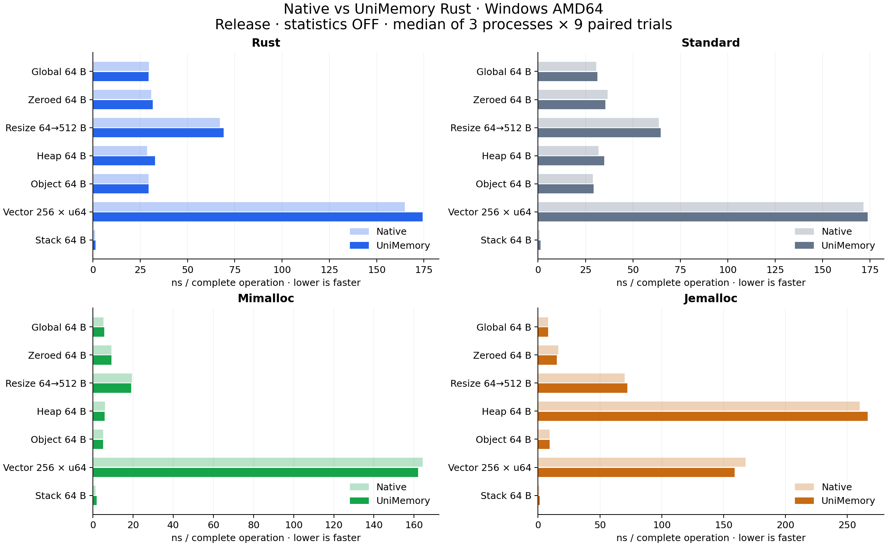

# UniMemory Rust

[](Cargo.toml) [](LICENSE)

Unified memory allocation with Rust, Standard, mimalloc or jemalloc. Select a backend at build time and manage memory through Global, Heap and Stack.

**English** · [简体中文](README.zh-CN.md)

## Features

- **🔄 Unified backends**: Switch allocators without changing application interfaces.
- **🧱 Objects and arrays**: Typed construction with automatic destruction and release.
- **📦 Containers**: Allocator-aware Vec and Box, plus global allocation for standard containers.
- **🗂️ Heap / Stack**: Independent groups, fixed buffers and checkpoints.
- **📊 Optional statistics**: Operation counts, live bytes and peak usage; disabled by default.

## Quick Start

Add the dependency to an existing Rust project:

```sh
cargo --config net.git-fetch-with-cli=true add unimemory --git https://github.com/dugan-dev/UniMemory-Rust
```

```rust
use unimemory::{Global, MemoryExt};

fn main() -> unimemory::Result<()> {
    let memory = Global::new();
    let value = memory.create(String::from("Hello, UniMemory!"))?;
    let values = memory.create_array(8, |i| i * i)?;

    assert_eq!(&**value, "Hello, UniMemory!");
    assert_eq!(values[3], 9);
    Ok(())
}
```

### Heap and Stack

```rust
use std::mem::MaybeUninit;
use unimemory::{Heap, MemoryExt, Stack};

let mut heap = Heap::new()?;
let value = heap.create(42)?;
drop(value);
heap.reset()?;

let mut buffer = [MaybeUninit::<u8>::uninit(); 4096];
let mut stack = Stack::new(&mut buffer);
let mark = stack.mark();
let values = stack.create_array(8, |i| i)?;
drop(values);
stack.rewind(mark)?;
```

Owners release their values automatically. Drop borrowed owners before bulk reclamation. Global is shareable across threads; Heap and Stack remain on their owning thread.

### Containers and Statistics

```rust
use unimemory::{Global, Memory, MemoryExt, StatisticsMode, Vec};

let memory = Global::with_statistics(StatisticsMode::Basic)?;
let mut values = Vec::new_in(memory.allocator());
values.extend(0u64..1024);
assert_eq!(memory.statistics().live_bytes, values.capacity() * 8);
```

`unimemory::Vec/Box` come from allocator-api2. Standard containers can use `NativeAllocator` globally; Rust-mode resources reuse the application's existing global allocator.

## Backends

| Cargo feature | Global | Heap | Stack |
| --- | --- | --- | --- |
| Default / `rust` | Rust application allocator | Rust allocation group | Borrowed buffer |
| `standard` | C++ new/delete | Standard allocation group | Borrowed buffer |
| `mimalloc` | mimalloc | Native heap | Borrowed buffer |
| `jemalloc` | jemalloc | Dedicated arena | Borrowed buffer |

Select one backend. For example, switch to mimalloc:

```toml
[dependencies]
unimemory = { git = "https://github.com/dugan-dev/UniMemory-Rust", features = ["mimalloc"] }
```

Container and statistics support are compiled by default; per-resource statistics start disabled. Set `default-features = false` for core allocation only.

## Performance

Measured on Windows x64 with identical native SDKs and build settings, statistics off. Light bars are native; solid bars are UniMemory. Lower times are faster.



## Build and Test

```sh
git clone --recurse-submodules https://github.com/dugan-dev/UniMemory-Rust.git
cd UniMemory-Rust
cargo run --example basic
cargo test --locked
```

Rust 1.85+ is required. mimalloc needs a C compiler; Standard needs a C++17 compiler; jemalloc requires native build tools and a separate SDK on Windows. Access to the private repository is required.

## Documentation

- **Getting started:** [Build and integration](docs/getting-started.md)
- **API:** [Design and ownership](docs/design.md)
- **Examples:** [Objects, containers and global allocation](examples/)
- **Performance:** [Complete charts and data](docs/performance.md)
- **Validation:** [Test scope and results](docs/validation.md)

## License

[MIT](LICENSE). Third-party sources and licenses are listed in [NOTICE](NOTICE).
