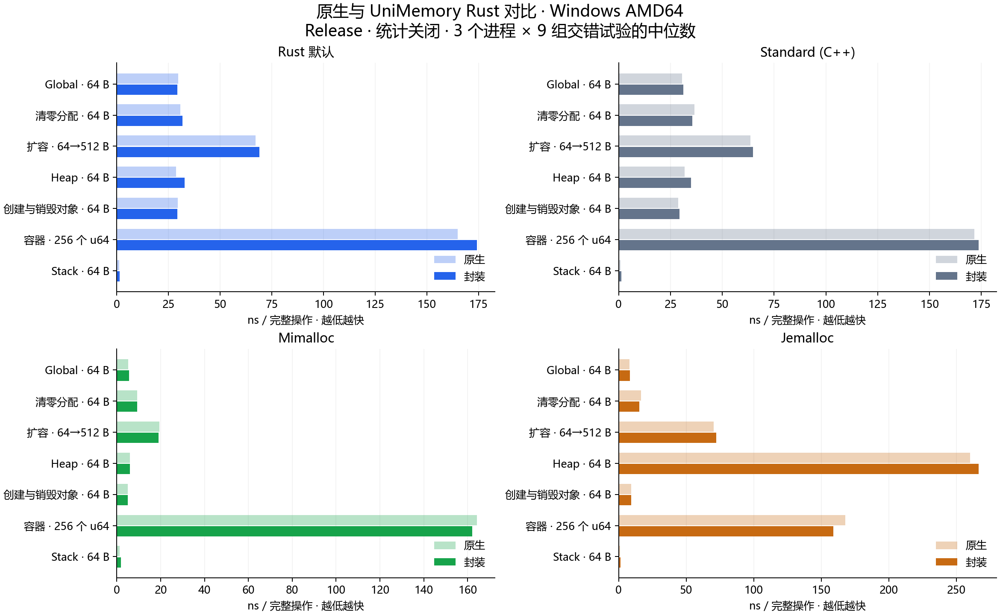

# UniMemory Rust

[](Cargo.toml) [](LICENSE)

统一 Rust、Standard、mimalloc 和 jemalloc 的内存分配接口。编译时选择后端，使用 Global、Heap、Stack 管理内存。

[English](README.md) · **简体中文**

## 特点

- **🔄 统一后端**：切换分配器，保持业务接口一致。
- **🧱 对象与数组**：类型化构造，自动析构和释放。
- **📦 容器接入**：独立分配器的 Vec、Box，以及标准容器的全局分配器。
- **🗂️ Heap / Stack**：独立分配组、固定缓冲区与检查点回收。
- **📊 可选统计**：分配次数、当前占用和峰值，默认关闭。

## 快速开始

在已有 Rust 项目中添加依赖：

```sh
cargo add unimemory --git https://github.com/dugan-dev/UniMemory-Rust
```

```rust
use unimemory::{Global, MemoryExt};

fn main() -> unimemory::Result<()> {
    let memory = Global::new();
    let value = memory.create(String::from("Hello, UniMemory!"))?;
    let values = memory.create_array(8, |i| i * i)?;

    assert_eq!(&**value, "Hello, UniMemory!");
    assert_eq!(values[3], 9);
    Ok(())
}
```

### 堆与栈

```rust
use std::mem::MaybeUninit;
use unimemory::{Heap, MemoryExt, Stack};

let mut heap = Heap::new()?;
let value = heap.create(42)?;
drop(value);
heap.reset()?;

let mut buffer = [MaybeUninit::<u8>::uninit(); 4096];
let mut stack = Stack::new(&mut buffer);
let mark = stack.mark();
let values = stack.create_array(8, |i| i)?;
drop(values);
stack.rewind(mark)?;
```

对象自动释放；整体回收前先释放借用它的对象。Global 可跨线程共享，Heap 和 Stack 在所属线程使用。

### 容器与统计

```rust
use unimemory::{Global, Memory, MemoryExt, StatisticsMode, Vec};

let memory = Global::with_statistics(StatisticsMode::Basic)?;
let mut values = Vec::new_in(memory.allocator());
values.extend(0u64..1024);
assert_eq!(memory.statistics().live_bytes, values.capacity() * 8);
```

`unimemory::Vec/Box` 是 allocator-api2 容器。标准容器可通过 `NativeAllocator` 接入全局分配器；已有全局分配器时，Rust 后端直接复用它。

## 后端

| Cargo feature | Global | Heap | Stack |
| --- | --- | --- | --- |
| 默认 / `rust` | Rust 应用分配器 | Rust 分配组 | 借用缓冲区 |
| `standard` | C++ new/delete | Standard 分配组 | 借用缓冲区 |
| `mimalloc` | mimalloc | 原生 heap | 借用缓冲区 |
| `jemalloc` | jemalloc | 独立 arena | 借用缓冲区 |

仅选择一个后端。例如切换到 mimalloc：

```toml
[dependencies]
unimemory = { git = "https://github.com/dugan-dev/UniMemory-Rust", features = ["mimalloc"] }
```

默认编译容器和统计支持，各对象的统计默认关闭。仅需核心分配功能时设置 `default-features = false`。

## 性能

Windows x64 实测，原生与封装使用相同 SDK 和编译配置，统计关闭。浅色为原生，深色为封装，耗时越低越快。



## 构建与测试

```sh
git clone --recurse-submodules https://github.com/dugan-dev/UniMemory-Rust.git
cd UniMemory-Rust
cargo run --example basic
cargo test --locked
```

要求 Rust 1.85+。mimalloc 需要 C 编译器；Standard 需要 C++17 编译器；jemalloc 还需原生构建工具，Windows 使用独立 SDK。私人仓库需有访问权限。

## 文档

- **开始使用：** [构建与接入](docs/getting-started.md)
- **接口：** [设计与所有权规则](docs/design.md)
- **示例：** [对象、容器与全局分配器](examples/)
- **性能分析：** [完整图表和数据](docs/performance.md)
- **验证：** [测试范围与结果](docs/validation.md)

## 许可证

[MIT](LICENSE)。第三方来源与许可证见 [NOTICE](NOTICE)。
