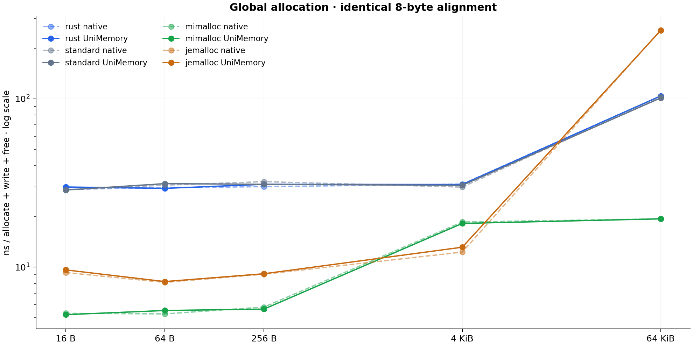
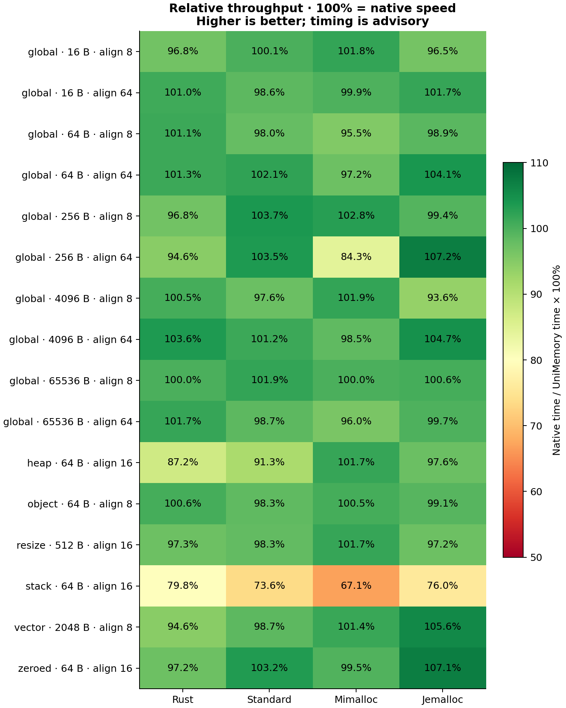

# Performance / 性能分析

Windows AMD64 · Release · 统计编译关闭 · 每项 3 个独立进程 × 9 次交错原生/封装试验。单位 ns/完整操作，越低越快。

## Workloads / 常见操作

浅色为原生，深色为 UniMemory Rust。


## Sizes / 分配规模

固定 8 字节对齐；虚线原生，实线封装。



## Relative throughput / 相对原生吞吐

100% 表示相同耗时；高于 100% 也可能来自采样和代码布局差异，不代表封装普遍比原生更快。



## Complete table / 全部数据

每格为 **原生 / 封装** 的中位数，覆盖所有已测项目。

| 操作 · 字节 · 对齐 | Rust | Standard | mimalloc | jemalloc |
| --- | ---: | ---: | ---: | ---: |
| global · 16 · 8 | 28.96 / 29.93 | 28.74 / 28.72 | 5.32 / 5.22 | 9.29 / 9.63 |
| global · 16 · 64 | 31.21 / 30.89 | 29.93 / 30.37 | 14.47 / 14.49 | 13.93 / 13.69 |
| global · 64 · 8 | 29.71 / 29.37 | 30.68 / 31.32 | 5.27 / 5.53 | 8.12 / 8.21 |
| global · 64 · 64 | 31.07 / 30.66 | 31.57 / 30.93 | 5.29 / 5.44 | 13.85 / 13.31 |
| global · 256 · 8 | 30.05 / 31.04 | 32.20 / 31.04 | 5.79 / 5.63 | 9.08 / 9.14 |
| global · 256 · 64 | 29.32 / 30.99 | 31.46 / 30.40 | 5.56 / 6.60 | 14.67 / 13.69 |
| global · 4096 · 8 | 31.13 / 30.99 | 29.88 / 30.63 | 18.53 / 18.18 | 12.29 / 13.13 |
| global · 4096 · 64 | 31.60 / 30.50 | 31.72 / 31.35 | 21.34 / 21.67 | 24.88 / 23.77 |
| global · 65536 · 8 | 103.91 / 103.95 | 103.10 / 101.16 | 19.36 / 19.36 | 255.74 / 254.34 |
| global · 65536 · 64 | 104.01 / 102.29 | 104.45 / 105.78 | 23.22 / 24.20 | 251.97 / 252.71 |
| heap · 64 · 16 | 28.69 / 32.90 | 31.82 / 34.84 | 5.98 / 5.88 | 260.12 / 266.64 |
| object · 64 · 8 | 29.50 / 29.33 | 28.81 / 29.30 | 5.01 / 4.99 | 9.30 / 9.38 |
| resize · 512 · 16 | 67.18 / 69.05 | 63.61 / 64.74 | 19.36 / 19.04 | 70.22 / 72.24 |
| stack · 64 · 16 | 1.10 / 1.38 | 0.97 / 1.32 | 1.26 / 1.87 | 1.12 / 1.48 |
| vector · 2048 · 8 | 164.95 / 174.28 | 171.55 / 173.75 | 164.26 / 162.02 | 167.95 / 159.06 |
| zeroed · 64 · 16 | 30.80 / 31.70 | 36.61 / 35.47 | 9.21 / 9.26 | 16.43 / 15.34 |

## Scope / 范围

- Rust：当前应用全局分配器；本次基准未替换它。Standard：C++ new/delete；不是 Rust System 的别名。
- mimalloc 3.3.2、jemalloc 5.3.1。原生和封装共享同一份 SDK 和相同参数；Windows 原生库统一静态链接、动态 MSVC CRT。
- Heap：mimalloc/ jemalloc 对比原生 heap/arena；Rust/Standard 没有同等原生分配组，基线为普通分配，封装额外提供分组回收。
- Stack：对比最小固定缓冲区控制，封装另有容量、检查点和生命周期规则；不调用上述原生堆后端。
- vector：两侧均使用 allocator-api2 Vec、相同预留、填充和销毁；原生侧直接调用选定后端，不混用默认 Vec。
- 同一可执行文件中先预热再交错计时；多进程后端顺序固定种子打乱；记录 CPU 绑定、源码/二进制/SDK 哈希和完整试验。
- 这些是本机微基准，不包括 RSS、GPU、长时间压力或跨平台性能结论。性能不是正确性门槛。

[原始试验](results/samples.csv) · [汇总表](results/summary.csv) · [环境与版本](results/benchmark.json)

## Reproduce / 复现

```sh
uv run --with matplotlib==3.10.7 python tools/benchmark.py
```

Windows 先运行 tools/native-jemalloc.ps1；原生 SDK 二进制保存在忽略的 artifacts/ 目录。
